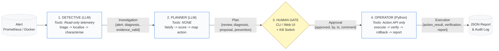

# Incident Zero: Three-Agent Architecture Overview

> **Target**: 1-Page Architecture Reference (Checkpoint 3: Hands)  
> **Details & Scenarios**: [architecture-details.md](architecture-details.md) | [interfaces.md](interfaces.md) | [RULES.md](RULES.md)

---

## 1. End-to-End Pipeline & Typed Hand-Offs

---

## 2. Core Architecture & Decision Bullets

1. **Detective (LLM + Read-Only Telemetry)**: Consumes incoming alerts and investigates using typed, read-only tools (`get_metrics`, `search_traces`, `search_logs`, `container_health`, `deploy_history`). Strictly prohibited from mutating system state or reading `flagd`. Validates citations in code and produces an `Investigation`.
2. **Planner (LLM + Zero Tools)**: Reviews and attempts to challenge/disprove the Detective's diagnosis. Operates with `tools=[]` to eliminate hallucinated tool calls. Maps root causes to remediations using a deterministic category $\to$ allowlist table, drafts root-cause prevention suggestions, and outputs a `Plan`.
3. **Human Gate (Explicit Consent + Kill Switch)**: Plain Python governance gate. Requires explicit typed `"yes"` in CLI or button click in UI (`runs/approvals/<run_id>.json`) before any mutation. Can be halted instantly via kill switch (`.killswitch` file or `KILL_SWITCH=1` env). Produces an `Approval`.
4. **Operator (Deterministic Python Runtime)**: Pure deterministic Python—**no free-form LLM**. Never modifies code or demo files directly. Dispatches ONLY approved proposals through the official Action API, monitors recovery, executes automated rollback upon failure, and outputs the final `Execution`.
5. **Decision Lifecycle (`triage -> localise -> characterise -> falsify -> finish`)**:
   - *Triage*: Check global health (`container_health`, top metric anomalies).
   - *Localise*: Identify failing service and error propagation path across distributed traces (`search_traces`).
   - *Characterise*: Pinpoint exact failure mechanism in application logs (`search_logs`) and resource metrics (`get_metrics`).
   - *Falsify*: Challenge hypothesis with alternative explanations (downstream dependency, CPU/memory starvation, upstream surge).
   - *Finish*: Synthesize findings, validate cited evidence IDs, and formulate prevention notes.
6. **Confidence & Evidence Rules**: Every diagnosis assertion must link to verifiable `Evidence` IDs recorded in the run log. Calibrated confidence is downgraded on thin evidence (<2 tools), unruled-out alternatives, or multi-service anomalies.
7. **Escalation Policy (Safe-by-Default)**: If confidence is low ($<0.70$), evidence is contradictory, or multiple root causes appear, the agent immediately escalates to a human engineer with an evidence summary (`decision="escalate"`). An honest escalation strictly outscores an incorrect fix.
8. **Telemetry Isolation & Flag Scrubbing**: All tool returns pass through an in-code scrubber that redacts `feature_flag*` keys and values. The agent never diagnoses via flagd state, ensuring legitimate observability-driven reasoning.
9. **Action Allowlist & Remediation Runbook**: Actions are restricted to a deterministic whitelist (`restart_service`, `start_service`, `disable_failure_flags`, `throttle_load`). Failure flags are toggled to "off" using a static runbook (`flag_runbook.yaml`) without ever reading live flag states.
10. **Automated Verification & Rollback**: Post-execution, the Operator actively queries Jaeger traces and Prometheus telemetry across a verification window (up to 180s). If signals remain unhealthy after 3 polling cycles, the Operator triggers an automatic rollback proposal and escalates.
11. **CI Enforcement & Traceability**: Architecture invariants are enforced by automated CI greps (Action API imports restricted to safety layer; Planner invoked with empty tool list; no flagd imports). Every hand-off across agent boundaries is recorded to `runs/run.jsonl` as an immutable `handoff` event (`from`, `to`, `summary`).
